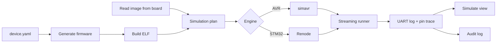

# Simulation paths: Arduino (AVR) and STM32

Status: S0 and S1 done (2026-11-20, branch `feat/fw-018-sim-paths`). S2 to S4
open. Decisions D1 to D4 made on 2026-11-20 (section 7). Work item: FW-018.

## 1. Goal

Oasis Studio runs firmware for two chip families in a simulator, with no
board connected:

- Arduino boards with AVR chips (first: ATmega328P on the Arduino Uno).
- STM32 chips (first: STM32F103 on the "Blue Pill" board).

The same path serves two uses:

1. **New firmware.** The user designs a device, generates firmware, and runs
   the firmware in the simulator before flashing a board.
2. **Existing firmware.** The user reads the firmware image back from a board
   that they own, then runs that image in the simulator to investigate,
   diagnose, or change the device behavior.

## 2. What exists now

| Item | AVR (Arduino) | STM32 |
|------|---------------|-------|
| Board names accepted by validation | `arduino_uno`, `arduino_mega`, `arduino_nano` (`src/config/validation.rs:32`) | `stm32f103`, `stm32f411` |
| Rust target in `TargetInfo` | none: falls to `""` (`src/codegen/mod.rs:51`) | `thumbv7m-none-eabi`, `thumbv7em-none-eabihf` |
| Firmware generation | fails: `UnsupportedBoard` (`src/codegen/mcu.rs:57`) | runs, but the output does not build (see section 4) |
| Flash family in `desktop/studio-core/boards.yaml` | `avr_uno` (avrdude) | `stm32` (probe-rs) |
| Simulator | simavr (vendored source in `simavr/`, GPL-3.0) | Renode (MIT) |
| Python wrapper | `simulation/emulators/simavr/wrapper.py` | `simulation/emulators/renode/wrapper.py` |
| Orchestrator and MCP server | `simulation/emulators/orchestrator.py`, `simulation/mcp_server.py` (`sim_start`, `sim_step`, ...) | same |
| Fixture firmware | `simulation/fixtures/avr_uno_serial/` (new) | `simulation/fixtures/stm32f103_usart/` (new) |

## 3. Measured results (2026-11-20, this Mac)

Tools found on PATH: `simavr`, `avr-gcc`, `arduino-cli` (core `arduino:avr`
1.8.6), `renode` (v1.16.1, link to `/Applications/Renode.app`). Not found:
`qemu-system-arm`, `arm-none-eabi-gcc`, `probe-rs`.

1. The Uno fixture compiled with `arduino-cli`. simavr ran the ELF and printed
   `tick 0` to `tick 5` on stdout.
2. The STM32F103 fixture compiled with `cargo` (no crate dependencies).
   Renode ran the ELF headless with `--disable-gui --plain` and wrote
   `oasis f103 hello` from USART1 to a file. Wall time: 2 to 3 s.

The commands are in `simulation/fixtures/README.md`.

## 4. Gaps found

### Firmware generation

- G1. AVR: `generate_cargo_toml` has no AVR entry, so `generate` returns
  `UnsupportedBoard` for every Arduino board (`src/codegen/mcu.rs:57`).
- G2. STM32: the generated `Cargo.toml` sets `arch-xtensa` on
  `embassy-executor` for every board (`src/codegen/mcu.rs:70`). This feature
  is for ESP32 only. STM32 needs `arch-cortex-m`.
- G3. STM32: the generated `main.rs` calls `embassy_hal::init`
  (`src/codegen/mcu.rs:137`). The generated `Cargo.toml` has no dependency
  with this name. The HAL crate is set to
  `version = "*"`. The output has no `memory.x` and no `.cargo/config.toml`.
  The generated STM32 project cannot build.

### Python wrappers

- G4. simavr wrapper: `set_gpio`, `send_uart`, and `trigger_interrupt` write
  `GPIO:`, `UART:`, and `INT:` lines to stdin
  (`simulation/emulators/simavr/wrapper.py:180`, `:196`, `:215`). The stock
  simavr program does not read stdin. The parser looks for lines that start
  with `UART:` (`:152`). Stock simavr prints UART text in ANSI color with no
  prefix. The wrapper gets no UART text from stock simavr.
- G5. Renode wrapper: the STM32F103 script adds GPIO ports A to C again
  (`simulation/emulators/renode/wrapper.py:60-62`). `stm32f103.repl` already
  has GPIO ports A to D, and the added lines use a wrong type name
  (`GPIO.STM32F1GPIOPort`; the correct name is `GPIOPort.STM32F1GPIOPort`).
- G6. Renode wrapper: the script path is fixed at `/tmp/oasis_renode.resc`
  (`:136`). Two runs at the same time overwrite each other. The wrapper waits
  a fixed 2 s for start-up (`:159`). The wrapper uses `--disable-xwt`; Renode
  1.16 also accepts the alias `--disable-gui`.
- G7. Renode wrapper: `STM32F401` uses `stm32f4.repl` (`:67`). That file
  describes an STM32F407-class chip. Renode 1.16 has no STM32F411 model.
  The nearest files are `stm32f4.repl` and `stm32f412.repl`.

### Desktop app

- G8. `KNOWN_TOOLS` (`desktop/studio-core/src/tools.rs:13`) does not list
  `simavr` or `renode`. The app cannot report if a simulator is present.
- G9. `run_with_timeout` in `tools.rs` keeps all output until exit. A
  simulator run needs line-by-line output to the UI. The FW-015 flash runner
  needs the same streaming runner.

### Platforms

- G10. simavr has no official Windows build. Renode has macOS, Linux, and
  Windows packages.

### Found during S0 and S1

- G11. simavr buffers stdout when stdout is a pipe. The UART text arrives
  only when simavr exits. Fix: the runner gives simavr a pseudo-terminal
  (pty) for stdout on macOS and Linux (`desktop/studio-core/src/runner.rs`,
  `simulation/emulators/simavr/wrapper.py`).
- G12. Renode cannot open a script given as a plain argument when the path
  has a space (error: "Could not tokenize here"). The app data folder on
  macOS (`Application Support`) has a space. Fix: start Renode with
  `-e 'include "<path>"'`. Inside a script, a path in double quotes can have
  spaces. `@'<path>'` and `@"<path>"` fail.
- G13. The old Renode wrapper read GPIO with `GetGPIO`. Renode 1.16 has no
  such command for `STM32F1GPIOPort`. `GetGPIOs` lists each pin as
  `(N, GPIO: set)` or `(N, GPIO: unset)`. Input uses `OnGPIO <pin> <bool>`.

## 5. Proposed design



### 5.1 Board table

Add a `simulate` block to each family in `desktop/studio-core/boards.yaml`.
The block uses the same placeholder rules as the flash `args`.

```yaml
  - family: avr_uno
    simulate:
      engine: simavr
      args: ["-m", "atmega328p", "-f", "16000000", "{artifact}"]
      accepts: [elf, hex]
  - family: stm32
    simulate:
      engine: renode
      platform: platforms/cpus/stm32f103.repl
      uart: usart1
      accepts: [elf, bin]
```

### 5.2 Rust back end (`desktop/studio-core/src/sim.rs`)

- `sim_plan(family, artifact)` returns a `SimPlan`. The plan has the same
  form as `FlashPlan`: engine, engine path, argument list, artifact SHA-256,
  and blockers. Blockers: engine missing, artifact missing, artifact type not
  accepted, family has no `simulate` block.
- `sim_run(plan, seconds)` starts the engine through the streaming runner
  (G9). The runner uses an argument list and no shell. The runner sends each
  UART line to the UI as a Tauri event. The runner stops the engine at the
  time limit, or when the user clicks Stop.
- For Renode, the app writes a `.resc` script into a new run folder under
  the app data folder. The script sets `$elf` and `$out`, loads the platform,
  connects the UART to a file, runs for the time limit, and quits. This form
  is the form proven by the fixture.
- Each run writes one audit record: engine, artifact SHA-256, time limit,
  exit reason.
- A simulation does not touch hardware. A simulation run does not need an
  owned-device record.

### 5.3 Firmware sources

| Source | AVR | STM32 |
|--------|-----|-------|
| Generated from `device.yaml` | Arduino sketch from the templates in `legacy/ino/`, built with `arduino-cli compile` (proven) | Rust with `embassy-stm32`, after G2 and G3 are fixed |
| User file | `.elf` or `.hex` | `.elf` or raw `.bin` |
| Read back from an owned board | `avrdude -U flash:r:<file>.hex:i` | probe-rs memory read to a `.bin` file (exact command not yet tested) |

The read-back image is also the backup that the flash plan needs before the
first flash. One read-back serves two purposes: a backup and a simulation
input. Renode loads a raw `.bin` file with `sysbus LoadBinary @<file> 0x08000000`.

### 5.4 Python package

The app does not ship Python. The Rust back end drives simavr and Renode
directly for UART and time-limit runs. The Python package in `simulation/`
stays the path for co-simulation with sensor models (for example, a DHT22
model that answers on a pin) through the MCP server. Fix G4 to G7 so the
MCP server works with stock simavr and Renode.

### 5.5 Simulate view

Add "Simulate" to the Build group in the app. The view has:

1. A firmware selector: last generated build, a file, or a read-back image.
2. A family selector, with the engine status (found or missing).
3. A time limit (default 5 s).
4. Run and Stop buttons.
5. A UART console.
6. The exit reason, and a link to the audit record.

The assistant gets two tools: `sim_plan` and `sim_run`. A person accepts each
`sim_run` before the run starts, the same rule as other assistant actions.

## 6. Phases

| Phase | Work | Done when |
|-------|------|-----------|
| S0 (done) | Fix G4 to G7 in the Python wrappers. Add pytest tests that run both fixtures. Add `simavr` and `renode` to `KNOWN_TOOLS` (G8). | Both fixture tests pass on macOS. CI runs them on Linux (`apt install simavr`, Renode portable package). |
| S1 (done) | `sim.rs` with `sim_plan` and the streaming runner (G9). Simulate view. UART only. | The app runs both fixtures and shows the expected UART text. |
| S2 | AVR generation (sketch + `arduino-cli`). STM32 generation fixes (G2, G3). | `examples/` gets one Uno and one STM32F103 device. Design → Generate → Simulate prints sensor log lines for both. |
| S3 | Pin traces: simavr VCD output (`-o <file>`, `-at <name>=portpin@...`); Renode GPIO state. Sensor models from `simulation/components/` through the MCP server. | A pin trace shows the LED pin toggle. A DHT22 model value appears in the UART log. |
| S4 | Read-back path (section 5.3) for owned boards. | A Uno image read back with avrdude runs in simavr and matches the board's serial output. |
| D1 test | Run the Uno fixture in avr8js in the app window. Compare the UART text with the simavr output. | The avr8js run prints `tick 0` to `tick 5`. Then decide if avr8js replaces the Windows blocker. |

S2 can start now (D2 is decided). Tool install work is FW-020
([TOOLCHAIN_SETUP_DESIGN.md](TOOLCHAIN_SETUP_DESIGN.md)).

## 7. Decisions (made 2026-11-20)

| Decision | Choice | Reason | Follow-up |
|----------|--------|--------|-----------|
| D1. AVR on Windows | A: no AVR simulation on Windows in v1. The Simulate view shows the blocker. | No new engine. One AVR engine (simavr) for the app and the Python MCP server. | Test avr8js with the Uno fixture (phase "D1 test"). Choose avr8js only if the UART text matches simavr. |
| D2. Arduino firmware language | A: Arduino C++ sketch, built with `arduino-cli`. | Proven on this Mac. The Arduino sensor libraries work. The `legacy/ino/` templates are a start. | The `arduino:avr` core is approximately 240 MB on this Mac (avr-gcc 215 MB, core 24 MB, avrdude 1.1 MB). The setup guide states this size. |
| D3. First STM32 chip | A: STM32F103 first. | Renode has an exact model. The fixture passes in the app. | Add STM32F411 later on the nearest Renode model. Mark those runs "approximate" in the plan. |
| D4. Simulator install | A: the user installs the tools. The app explains each tool and gives the steps. | Small installer. No bundled binaries to sign. No licence work in v1. | FW-020: install guide, setup wizard on macOS, Windows, and Linux, then app-managed download (option C) for a missing tool. See [TOOLCHAIN_SETUP_DESIGN.md](TOOLCHAIN_SETUP_DESIGN.md). |

### Options that were not chosen

- D1 B: avr8js in the app window. One engine on all systems and no install,
  but a second AVR engine beside simulation in Python, and a second run path
  outside the Rust runner.
- D2 B: Rust with `avr-hal`. One generated language, but a nightly toolchain,
  few sensor crates, and no test here.
- D3 B: STM32F411 first. A popular board, but no exact Renode model (G7).
- D4 B: the installer includes the simulators. Renode is 215 MB on this Mac
  (`/Applications/Renode.app`). Each bundled binary needs signing and
  notarization on macOS. simavr is GPL-3.0, so a bundle must carry the
  licence text and the source.
