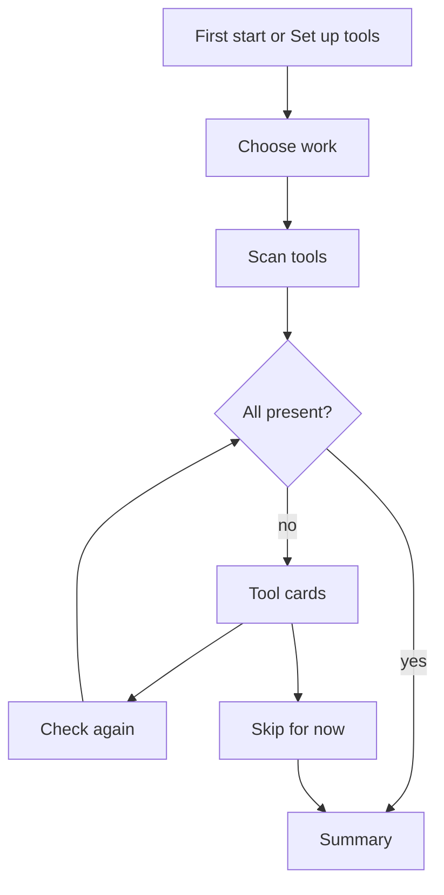

# Tool setup in Oasis Studio: guide, wizard, and app-managed download

Status: design, 2026-11-20. Work item: FW-020. Phase W0 is done (the guide
[INSTALL_TOOLCHAINS.md](INSTALL_TOOLCHAINS.md)). W1 to W3 are open.

Source decision: D4 in
[SIMULATION_PATHS_AVR_STM32.md](SIMULATION_PATHS_AVR_STM32.md) section 7.
The user installs the tools in v1. The app explains each tool and gives the
steps. A later phase lets the app download a missing tool.

## 1. Goal

A new user goes from "nothing installed" to a passing first run of one kind
of work (for example "simulate an STM32F103"), with help from the app only.
The app tells the user:

1. which tools the chosen work needs,
2. why the work needs each tool,
3. which tools are present, with path and version,
4. the exact install steps for this operating system,
5. which work is ready and which work is blocked, with the reason.

## 2. Rules for the user experience

Desktop toolchain installers often make the same errors. This design avoids
these errors on purpose:

| Error to avoid | Rule in this design |
|----------------|---------------------|
| Large downloads that start with no warning | The app shows the size of each tool before any step. The app never downloads a tool without a click (W3). |
| Component names with no explanation | Each tool card says what the tool does and which work needs the tool, in one or two sentences. |
| One failed component stops all setup | Each tool has its own status. A failure blocks only the work that needs that tool. |
| The app is not usable until setup is complete | Setup is optional. Design, Devices, and Activity work with no tools. The user can skip setup. |
| Errors with no next step | Each blocker names the missing tool and links to the tool card. |
| Hidden install locations | The app shows the path of each tool that it found. |
| Setup that cannot be checked again | A "Check again" button runs the tool scan at any time. |

## 3. One source of truth: `toolchains.yaml`

Today the tool list is the `KNOWN_TOOLS` constant in
`desktop/studio-core/src/tools.rs:13`. W1 replaces the constant with a data
file, `desktop/studio-core/toolchains.yaml`, in the same style as
`desktop/studio-core/boards.yaml`. The Hardware page, the wizard, the
blockers, the in-app assistant, the MCP server (`oasis-studio-mcp`), and
the guide all use this file.

```yaml
tools:
  - id: renode
    name: Renode
    purpose: "Simulates STM32 chips, so you can run firmware with no board."
    needed_by: [simulate.stm32]
    licence: MIT
    size_mb: 215
    version_arg: "--version"
    min_version: "1.16.0"
    extra_paths:
      macos: ["/Applications/Renode.app/Contents/MacOS"]
    install:
      macos:
        - text: "Download renode_<version>.dmg and drag Renode into Applications."
          url: "https://github.com/renode/renode/releases"
      windows:
        - text: "Download and run the Windows installer."
          url: "https://github.com/renode/renode/releases"
      linux:
        - text: "Download the portable package, check the SHA-256, extract it, and add the folder to PATH."
          url: "https://github.com/renode/renode/releases"
    after_install: []
    # W3 only: pinned archives for app-managed download.
    download: []
  - id: avrdude
    name: avrdude
    purpose: "Writes firmware to an Arduino Uno over USB."
    needed_by: [flash.avr_uno]
    version_arg: "-?"
    extra_paths:
      # The arduino:avr core includes avrdude here.
      macos: ["~/Library/Arduino15/packages/arduino/tools/avrdude/*/bin"]
      linux: ["~/.arduino15/packages/arduino/tools/avrdude/*/bin"]
      windows: ["%LOCALAPPDATA%/Arduino15/packages/arduino/tools/avrdude/*/bin"]
    install:
      macos:
        - command: ["brew", "install", "avrdude"]
```

Each install step is a text line, a command, or a link. A command is a list
of arguments. In W1 and W2 the app shows a command and gives a Copy button.
The app does not run install commands. The user runs each command in a
terminal. This keeps the rule in `tools.rs`: the app never runs a shell.

Work names (`simulate.stm32`, `flash.avr_uno`, `build.arduino`, ...) come
from the families in `boards.yaml`. A test checks that each `needed_by`
name exists, and that each tool in `toolchains.yaml` has a section in
[INSTALL_TOOLCHAINS.md](INSTALL_TOOLCHAINS.md).

## 4. Wizard flow (W2)



1. **Start.** At the first start, the app asks one question: "Set up tools
   now, or later?" The Hardware page has a "Set up tools" button that opens
   the wizard at any time.
2. **Choose work.** The user selects the work: "Simulate an Arduino Uno",
   "Simulate an STM32F103", "Build and flash an ESP32", and so on. The app
   shows the total size of the missing tools for the selection.
3. **Scan.** The app runs the tool scan (`tools::list`, with the extra paths
   from the data file). The app compares each version with `min_version`.
4. **Tool cards.** One card for each missing or old tool:
   - name, purpose, and the work that needs the tool;
   - size and licence;
   - the steps for this operating system, with a Copy button for each
     command and a link for each download;
   - the steps after install (for example: the Linux `dialout` group, then
     log out and log in);
   - a "Check again" button for this tool.
5. **Summary.** A table of the chosen work. Each row is "ready" or
   "blocked", with the missing tool names.

### 4.1 Differences between operating systems

| System | What the app checks first | Notes |
|--------|---------------------------|-------|
| macOS | Xcode Command Line Tools (`xcode-select -p`), Homebrew (`brew`) | If Homebrew is missing, the first card is Homebrew. Each step with `brew` names the step without Homebrew, where one exists. |
| Windows | `winget` | AVR simulation is blocked (decision D1). The card says so and gives the reason. USB serial drivers (CH340, CP210x) get a card when a board is on USB and has no COM port. |
| Linux | The distribution, from `ID` and `ID_LIKE` in `/etc/os-release` | The card shows `apt`, `dnf`, or `pacman` commands. Membership of the `dialout` group (`uucp` on Arch) is a check with its own card. |

### 4.2 Blockers in other pages

The Simulate and Flash pages show blockers now (for example "Renode not
found"). In W1, each blocker for a missing tool gets a link to that tool's
card. The tools `list_tools`, `flash_plan`, and `sim_plan` (in the in-app
assistant and in `oasis-studio-mcp`) return the same tool id and steps, so
that an assistant can tell the user the exact step.

## 5. App-managed download (W3, option C)

W3 adds an "Install for me" button to a tool card. The button is shown only
for a tool with a pinned archive for this system and processor.

Rules:

1. Each archive has a fixed URL and a fixed SHA-256 value in
   `toolchains.yaml`. The app refuses an archive with a different value.
2. The app downloads over HTTPS into a new folder:
   `<app data>/toolchains/<tool>/<version>/`. The app runs no install
   script, needs no administrator permission, and changes no system
   folder.
3. The app writes one activity log record for each install: tool,
   version, URL, SHA-256.
4. The tool scan looks in PATH first, then in the app folder. A tool that
   the user installed wins. The Hardware page shows which copy the app
   uses.
5. "Remove" deletes the version folder.
6. When the user starts work that needs a missing tool, the blocker offers
   "Install for me" next to the manual steps.

### 5.1 Which tools can use W3

| Tool | Official archive | W3 status |
|------|------------------|-----------|
| arduino-cli | one file for each system | yes |
| Renode | Linux portable `.tar.gz`; macOS `.dmg`; Windows installer | Linux yes. macOS and Windows need a test: the `.dmg` must be mounted, and the Windows package is an installer. |
| probe-rs, espflash | release archives | yes, after a test on each system |
| picotool | `pico-sdk-tools` releases | test needed |
| simavr | no official binaries | no. The user installs simavr from a package manager. |
| Rust | the rustup installer | no. rustup is its own manager. The card links to rustup. |

### 5.2 Open questions for W3

- macOS can block a downloaded program that has no notarization. Test
  each tool: download it from the app, then start it from the app.
- Pinned versions get old. W3 needs a step in the release checklist
  ([STUDIO_RELEASE.md](STUDIO_RELEASE.md)) that updates the URLs and
  the SHA-256 values.

## 6. Phases

| Phase | Work | Done when |
|-------|------|-----------|
| W0 (done) | [INSTALL_TOOLCHAINS.md](INSTALL_TOOLCHAINS.md): what each work needs, why, and the steps for macOS, Windows, and Linux. | The guide is in the repository. |
| W1 | `desktop/studio-core/toolchains.yaml` replaces `KNOWN_TOOLS`. Extra search paths (the Arduino core avrdude, Renode). Hardware page shows purpose, size, and steps for this system. Blockers link to the tool card. The data file test. | On this Mac, the Hardware page finds avrdude in the Arduino core folder. Each blocker for a missing tool shows the steps for this system. |
| W2 | Wizard: first-start question, work selection, tool cards, summary. Checks for Homebrew, winget, Linux distribution, and serial group. | On a clean macOS user account, a Windows 11 VM, and an Ubuntu 24.04 VM, a tester follows only the wizard and gets one passing Simulate run (STM32F103 on all three; Uno on macOS and Linux). |
| W3 | "Install for me" for the tools in section 5.1 with status "yes". | The same three systems install arduino-cli and Renode (Linux) from the app. A changed SHA-256 value makes the install fail with a clear message. |

## 7. Found while writing this design

- On this Mac, arduino-cli installed avrdude 6.3.0-arduino17 in
  `~/Library/Arduino15/packages/arduino/tools/avrdude/6.3.0-arduino17/bin/`.
  avrdude is not on PATH. The Hardware page shows avrdude as missing.
  The Arduino Uno flash plan is blocked for the same reason
  (`desktop/studio-core/src/flash.rs:76` uses the same lookup). W1 fixes
  this with the extra search path.
